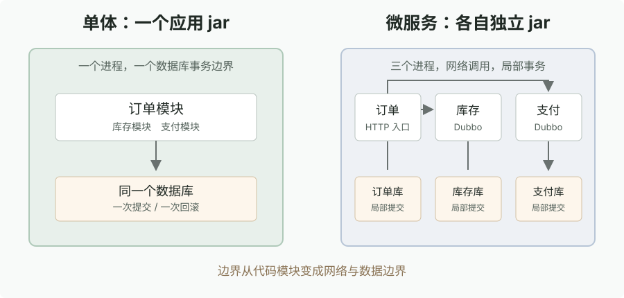
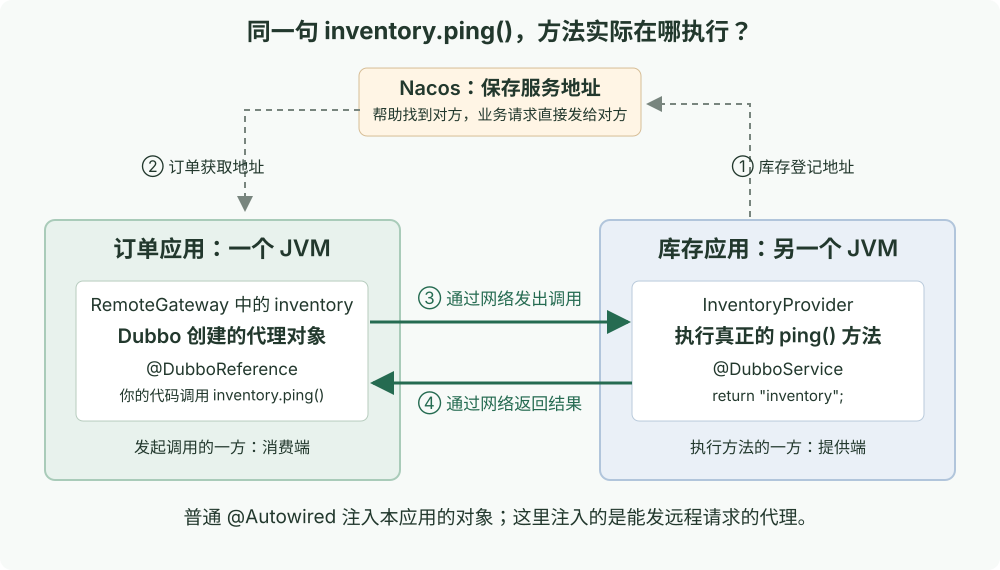
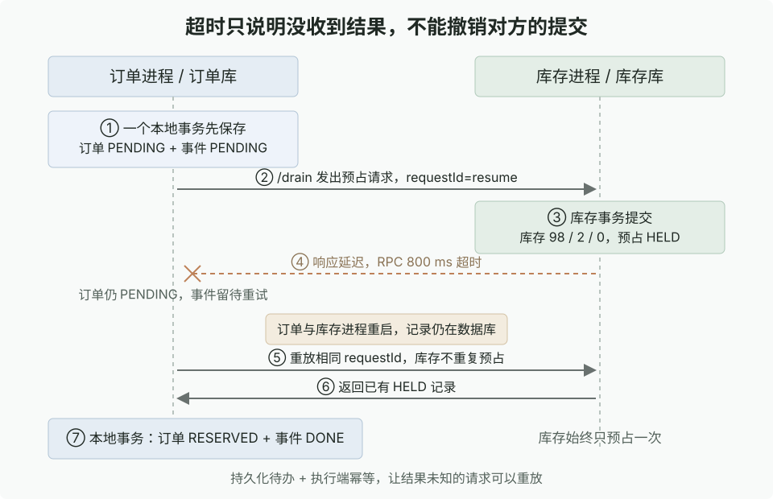

> 2026 年 9 月翻新：已更新配套代码、依赖说明和配置，使用 Docker、Nacos 2.4、Dubbo 3.3 与真实 MySQL 8 验证。Demo 源码见文末说明。

在单体架构里，写业务代码非常舒适：Controller 接收参数，Service 组织逻辑，库存和订单在同一个 JVM 内存里直接方法调用，外层套一个 `@Transactional` 或者 `TransactionTemplate`。遇到异常直接抛出，数据库事务自动全盘回滚，几乎不用操心一致性。

但业务一旦膨胀，单体的痛点立刻暴露：
1. **发布耦合**：库存规则改了一行代码，必须把整个几十兆的单体应用停机重新发布；
2. **故障蔓延**：库存如果是热点，把整个 JVM 的连接池或 CPU 吃满，原本不相关的历史订单查询接口也会跟着瘫痪；
3. **扩展受限**：无法针对高频的订单/库存服务单独做横向扩容。

这篇记录将一个原本一体化的订单、库存、支付单体应用，彻底拆分为独立微服务的完整过程：从进程解耦、Dubbo 3.3 远程调用、Nacos 注册发现与动态配置、Spring Cloud Gateway 网关，到微服务最凶险的**超时网络不确定性、业务幂等与 Outbox 最终一致性**。

---

## 架构演进拓扑

~~~text
【单体时代】
用户请求 → OrderController → Orders (本地调用) → InventoryModule / PaymentModule
          └── 连接同一个数据库，共用一个本地数据库事务 ──┘

【微服务时代】
用户请求 → Spring Cloud Gateway (端口 18180，统一路由分发)
             ↓ HTTP (lb://orders)
           OrderService (订单进程，端口 18183，独立库 amdemo_orders)
             ├── Dubbo 3.3 RPC → InventoryService (库存进程，独立库 amdemo_inventory)
             └── Dubbo 3.3 RPC → PaymentService   (支付进程，独立库 amdemo_payment)
             
* 支撑基础设施：Nacos 2.4 (服务发现 + 动态配置) + Sentinel (流控保护)
~~~

---

## 一、基准线：单体架构与其本地事务

在改造前，我们先看单体是怎么跑的。`monolith-service` 中，库存扣减与订单创建处于同一个本地数据库事务中：

~~~java
// Monolith 订单创建事务
public OrderResult place(String requestId, long userId, String sku, int quantity) {
    return database.transaction(status -> {
        // 1. 同进程调用库存模块进行扣减
        int changed = database.jdbc.update("""
            UPDATE stock SET available = available - ?, locked = locked + ?
            WHERE sku = ? AND available >= ?
            """, quantity, quantity, sku, quantity);
        if (changed == 0) throw new BusinessConflict("insufficient stock");
        
        // 2. 插入订单并标记为 RESERVED
        orderRepo.insert(requestId, userId, sku, quantity, "RESERVED");
        return OrderResult.reserved(requestId);
    });
}
~~~

启动单体并验证：

~~~bash
mvn -B -ntp -pl monolith-service -am package
bash scripts/init-secrets.sh
docker compose up -d --wait mysql monolith
curl -sS http://127.0.0.1:18182/health
# {"role":"monolith","ready":true}
~~~

下一单并付款：

~~~bash
# 下单：一步完成库存预占
curl -i http://127.0.0.1:18182/orders \
  -H 'Content-Type: application/json' \
  -d '{"requestId":"mono-1","userId":7,"sku":"SKU-A","quantity":2}'

# 支付：单事务内完成记账与库存确认
curl -sS http://127.0.0.1:18182/pay \
  -H 'Content-Type: application/json' \
  -d '{"requestId":"mono-1"}'

# 查看快照
curl -sS http://127.0.0.1:18182/snapshot
~~~

此时库存精确流转为 `available: 98, locked: 0, sold: 2`。如果中途抛异常，外层 `database.transaction()` 会把所有 SQL 全部回滚。

**这就是单体最美妙的地方：强一致性全交给 MySQL 事务管。接下来把代码拆分到不同进程，这个前提就彻底荡然无存了。**

---

## 二、服务拆分：进程与代码工程重构

拆分后，系统分为独立的 Maven 模块与应用镜像：

~~~text
architecture-demo/
├── pom.xml                 (BOM 版本管理)
├── demo-contracts/         (共用 RPC 接口契约，打成普通 jar)
├── demo-support/           (JDBC、事务、基础数据源支撑库)
├── monolith-service/       (保留对比用的单体)
├── order-service/          (订单微服务，独立进程)
├── inventory-service/      (库存微服务，独立进程)
├── payment-service/        (支付微服务，独立进程)
└── gateway-service/        (Spring Cloud Gateway HTTP 网关)
~~~

### 2.1 契约接口抽取（`demo-contracts`）

调用方和提供方都不依赖对方的业务实现，双方仅依赖轻量级的接口定义模块：

~~~java
// demo-contracts/.../InventoryRpc.java
public interface InventoryRpc {
    String ping();
    String apply(String operation, String requestId, String sku, int quantity);
}
~~~

### 2.2 Dubbo 3.3 提供端与消费端装配

在库存端实现并发布远程服务（`InventoryProvider.java`）：

~~~java
@DubboService(version = "1.0.0", group = "architecture-demo")
public class InventoryProvider implements InventoryRpc {
    @Autowired
    private InventoryModule inventory;

    @Override
    public String apply(String operation, String requestId, String sku, int quantity) {
        return inventory.apply(operation, requestId, sku, quantity);
    }
}
~~~

在订单端引入代理引用（`RemoteGateway.java`）：

~~~java
@DubboReference(
    version = "1.0.0",
    group = "architecture-demo",
    timeout = 800,
    retries = 0,
    check = false,
    lazy = true
)
private InventoryRpc inventory;
~~~

配置要点：
- `timeout = 800`：调用超时时间设定为 800ms；
- `retries = 0`：**在非幂等或带副作用的写操作中，严禁开启框架级自动重试**（避免超时后 Dubbo 盲目再发一次导致重复扣库存）；
- `dubbo.registry.address` 配置为 `nacos://${NACOS_ADDR:127.0.0.1:8848}`，服务启动后自动向 Nacos 上报自己的网络地址。

---

## 三、微服务实测：拆开到底带来了什么好处？

我们先把微服务集群拉起来：

~~~bash
docker compose up -d --wait nacos
python3 scripts/init-config.py
mvn -B -ntp -pl order-service,inventory-service,payment-service -am package
docker compose up -d --build --wait inventory payment orders
~~~

测试 RPC 链路握手：

~~~bash
curl -i http://127.0.0.1:18183/rpc-health
# {"inventory":"inventory","payment":"payment","transport":"dubbo"}
~~~

现在来亲手验证微服务拆分的核心收益：

### 3.1 独立交付：改动库存代码，订单支付零感知

修改了库存模块的代码后，只重新构建库存镜像并重启容器：

~~~bash
mvn -B -ntp -pl inventory-service -am package
docker compose up -d --no-deps --build --force-recreate --wait inventory
~~~

比对容器 ID：订单（`orders`）和支付（`payment`）容器一直在持续运行，内存连接和会话完全不受影响。Dubbo 客户端自动感知 Nacos 实例上下线并在几秒内恢复连接。

### 3.2 故障隔离：库存彻底宕机，历史订单查询依旧可用

直接拔掉库存服务的“电源”：

~~~bash
docker compose stop inventory
~~~

此时用户查询历史订单：

~~~bash
curl -sS http://127.0.0.1:18183/orders/cloud-1
# 返回 200 OK，PAID 状态正常输出
~~~

因为读订单只依赖 `amdemo_orders` 库，下游库存的崩溃丝毫没有波及核心查询链路。

---

## 四、基础设施补全：Gateway 网关与 Nacos 动态配置

### 4.1 Spring Cloud Gateway 统一流量入口

引入 `gateway-service`（端口 18180），前端从此无需硬编码各内部微服务的物理端口：

~~~yaml
# gateway-service/src/main/resources/application.yml
spring:
  cloud:
    gateway:
      routes:
        - id: orders
          uri: lb://orders
          predicates:
            - Path=/api/orders/**, /api/pay, /api/cancel
          filters:
            - StripPrefix=1
~~~

通过 Nacos 服务发现 + LoadBalancer 动态寻址：

~~~bash
mvn -B -ntp -pl gateway-service -am package
docker compose up -d --build --wait gateway

# 前端通过网关直接访问
curl -sS http://127.0.0.1:18180/api/orders/cloud-1
~~~

### 4.2 Nacos 动态配置热更新

在 Nacos 控制台（`http://127.0.0.1:18848/nacos/`）中修改 `orders.yaml`：

~~~yaml
demo:
  message: hello-from-nacos-live
~~~

无需重启应用容器，订单服务监听 `EnvironmentChangeEvent`，动态配置在毫秒级内无感生效：

~~~bash
curl -sS http://127.0.0.1:18183/config
# {"message":"hello-from-nacos-live"}
~~~

---

## 五、Sentinel 动态流控保护

在库存端嵌入 Sentinel 保护核心方法（`InventoryProvider.java`）：

~~~java
try (Entry entry = SphU.entry("inventory.reserve")) {
    return inventory.apply(operation, requestId, sku, quantity);
} catch (BlockException blocked) {
    return "RETRY:sentinel"; // 降级返回，告知调用端限流
}
~~~

规则通过 Nacos 动态下发（`inventory-flow.json`）：

~~~json
[
  {
    "resource": "inventory.reserve",
    "grade": 1,
    "count": 0
  }
]
~~~

当 `count` 设为 0 时，所有新到的库存预占请求瞬间被拦截并阻断在库存边界外，保护底层的 MySQL 数据库不被大流量打穿。

---

## 六、微服务最深的水：超时、幂等与 Outbox 最终一致性

跨网络调用带来的最大挑战：**网络超时不代表失败**。

### 6.1 超时假死复现：库存明明扣了，订单却超时报错

我们在实验中故意注入网络延迟（Dubbo 超时 800ms，库存端执行完后故意 sleep 1500ms）：

~~~bash
# 下单请求
curl -sS http://127.0.0.1:18183/orders -d '{"requestId":"cloud-timeout","userId":7,"sku":"SKU-A","quantity":2}'
curl -sS http://127.0.0.1:18184/fault -d '{"mode":"after"}'
curl -sS -X POST http://127.0.0.1:18183/drain
~~~

执行结果：
- 订单端收到 `RpcException: timeout`，状态被迫停留在 `PENDING`；
- 但是检查库存库，库存实际上已经扣掉了 2 件！

如果调用方盲目重试，或者直接当作失败把单子废弃，库存就直接产生了“少卖”的账实不符。

### 6.2 业务幂等设计：`reservation` 状态机短路

库存端解决超时的核心不是拼命加大 timeout，而是**建立幂等识别表**：

~~~sql
CREATE TABLE reservation (
    request_id VARCHAR(80) PRIMARY KEY,
    sku VARCHAR(40) NOT NULL,
    quantity INT NOT NULL,
    state VARCHAR(12) NOT NULL -- NEW, HELD, CONFIRMED
);
~~~

在扣库存的本地事务中：
1. 依赖 `request_id` 主键唯一性插入或锁定记录；
2. 若检查到当前记录的 `state` 已经为 `HELD`，说明前一次超时调用实际上已经在数据库提交成功了；
3. **直接短路返回成功，坚决不二次执行 `UPDATE stock` 扣减**。

### 6.3 订单端 Outbox 状态机

订单端同样不能依赖纯内存重试。通过本地消息表（Outbox 表），订单在本地事务中将下单意向持久化：

~~~sql
-- 同一事务内写入：
INSERT INTO orders (id, status) VALUES ('cloud-timeout', 'PENDING');
INSERT INTO outbox (request_id, kind, status) VALUES ('cloud-timeout', 'RESERVE', 'PENDING');
~~~

后台调度器（或 Demo 中的 `/drain`）不断扫描未完成的待办任务进行重放：
- 哪怕订单服务自身在超时期间崩溃重启，恢复后从 Outbox 捞出 `cloud-timeout` 再次发起 RPC；
- 下游库存服务凭借 `reservation` 幂等表识别并返回成功；
- 订单顺利推进为 `RESERVED`，状态机平滑自愈。

### 6.4 跨服务支付链路与补偿

支付场景同理：
1. 订单端调用支付服务完成记账；
2. 随后调用库存服务将 `locked` 转为 `sold`；
3. 若第二步因网络波动超时，订单状态保持为 `PAY_PENDING`；
4. 后续任务重放时，支付服务依据 `request_id` 幂等返回已有账单，库存服务补做确认，最终订单推进为 `PAID`。

---

## 七、全自动化回归测试

Demo 附带了一套完整的系统化验证脚本：

~~~bash
# 1. 验证应用 jar 包结构与依赖隔离（无混入对方实现）
python3 scripts/verify-packaging.py

# 2. 验证微服务业务全流程（幂等、超时恢复、故障注入）
python3 scripts/verify.py
python3 scripts/verify-cloud.py

# 3. 验证单服务独立部署与停机隔离性
python3 scripts/verify-deployment.py
~~~

测试矩阵覆盖：单体回滚、Dubbo 超时自愈、高并发库存争用、Nacos 动态配置秒级推送、Gateway 路由负载均衡、Sentinel 零阈值流量拦截与独立容器热更新。测试断言全绿通过。

清理环境：

~~~bash
docker compose down
~~~

通过这一套实践，系统彻底走通了从“单体单库”到“分布式高可用微服务”的完整架构演进。
