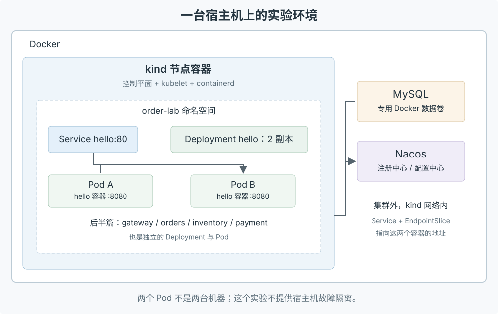

> 2026 年 9 月 14 日更新：补充 kind 实验环境、完整部署文件和配套源码。Demo 源码与部署配置见文末说明。

上一篇把[订单、库存、支付拆成了独立微服务](/posts/architecture-demo/)，本地靠一组 `compose.yaml` 跑得顺风顺水。

但在单机 Compose 跑微服务，局限很明显：
1. **故障自愈能力弱**：单机容器挂了靠 `restart: always` 还能拉起，但若物理机宕机，没有任何跨节点的实例漂移能力；
2. **滚动发布与回滚笨重**：发新版本时如果直接 `up -d`，要么瞬时断流，要么得人工准备多套端口和反代 upstream；
3. **服务与配置耦合死板**：每次扩个实例都要改 Compose 端口映射或 scale 之后重载反代。

既然架构已经微服务化了，索性把部署栈也搬上 Kubernetes。为了避免一上来就花钱租云上多台机器，这里选用 **kind（Kubernetes IN Docker）**，直接利用本机的 Docker 守护进程拉起一组容器来充当 K8s 节点，搭建轻量级本地实验集群。

这篇记录把单机 Docker Compose 迁移到 Kubernetes 的全流程：先拿一个轻量探针服务摸透 Pod、Deployment、Service、探针与滚动更新的底层逻辑，再把网关、订单、库存、支付以及 Nacos/MySQL 整套搬进集群，顺带记下几个极为隐蔽的部署坑。

---

## 核心对象与架构拓扑

在动手写 YAML 之前，先把整个迁移里反复打交道的几个 K8s 核心实体理顺：

- **Pod**：容器真正运行的物理载体，具备独立 IP 和网络命名空间，生命周期是短暂的（随时可能重建换 IP）；
- **Deployment**：工作负载管理器，负责声明期望的镜像版本、副本数（replicas）与滚动更新策略，并通过 ReplicaSet 确保 Pod 实例“坏了就补、多了就删”；
- **Service**：稳定的四层访问入口，给动态变动的 Pod 集合分配固定的集群内 DNS 域名与 ClusterIP，根据标签选择器（selector）把请求负载均衡到就绪端点；
- **ConfigMap & Secret**：将配置、环境变量与明文/敏感密钥从镜像中抽离，通过环境变量或只读卷挂载注入容器。

整体实验拓扑如下：

---

## 一、搭建本地 kind 实验集群

### 1.1 安装与环境检查

本次实战固定版本：kind **v0.33.0**、Kubernetes 节点镜像 **v1.35.8**。宿主机建议预留 4 核 CPU、6 GiB 以上可用内存。

检查本地环境：

~~~bash
docker info
kind version
kubectl version --client
~~~

### 1.2 集群编排与隔离配置

集群配置文件 `k8s/kind.yaml` 将控制平面的 API Server 绑定在本机 127.0.0.1：

~~~yaml
kind: Cluster
apiVersion: kind.x-k8s.io/v1alpha4
nodes:
  - role: control-plane
networking:
  apiServerAddress: "127.0.0.1"
~~~

执行初始化脚本拉起集群：

~~~bash
bash k8s/scripts/create-cluster.sh
export KUBECONFIG="$PWD/target/kubeconfig"
kubectl --context kind-architecture-lab get nodes
~~~

应看到节点 `architecture-lab-control-plane` 状态为 `Ready`。

为了操作清爽，后续资源统一放置在独立的 `order-lab` 命名空间下。可以在终端里配一个别名快捷函数：

~~~bash
k() { kubectl --context kind-architecture-lab -n order-lab "$@"; }
k get pods
~~~

---

## 二、从一个探针服务摸透 K8s 工作原理

先不急着直接上几百兆的 Java 大应用，用一个轻量级 Python HTTP 服务（`k8s/hello/server.py`）做探针：它只暴露 `/`（返回实例名与版本）、`/ready` 与 `/health`，方便我们肉眼观察实例扩缩容、探针切流与滚动替换。

### 2.1 镜像存储隔离：为什么宿主机镜像节点看不到？

构建 v1 探针镜像：

~~~bash
docker build --build-arg APP_VERSION=v1 -t architecture-hello:v1 k8s/hello
~~~

注意：**宿主机 Docker 与 kind 节点容器内部的 containerd 使用的是完全独立的镜像存储！** 如果直接在 K8s 里声明使用 `architecture-hello:v1`，节点在本地找不到镜像，就会去远端 Docker Hub 疯狂拉取并报 `ImagePullBackOff`。

必须执行镜像载入命令：

~~~bash
kind load docker-image --name architecture-lab architecture-hello:v1
~~~

这相当于把宿主机构建好的镜像直接 sideload 到 kind 节点的 containerd 存储池中。

### 2.2 声明 ConfigMap 与 Deployment

将非敏感配置抽取为 ConfigMap（`k8s/hello/config.yaml`）：

~~~yaml
apiVersion: v1
kind: ConfigMap
metadata:
  name: hello-config
  namespace: order-lab
data:
  MESSAGE: "hello from Kubernetes"
~~~

编写 Deployment 声明期望状态（`k8s/hello/deployment.yaml` 核心节选）：

~~~yaml
apiVersion: apps/v1
kind: Deployment
metadata:
  name: hello
  namespace: order-lab
spec:
  replicas: 2
  selector:
    matchLabels:
      app: hello
  template:
    metadata:
      labels:
        app: hello
    spec:
      containers:
        - name: hello
          image: architecture-hello:v1
          imagePullPolicy: IfNotPresent
          ports:
            - containerPort: 8080
          envFrom:
            - configMapRef:
                name: hello-config
~~~

提交资源并观察状态：

~~~bash
k apply -f k8s/hello/config.yaml
k apply -f k8s/hello/deployment.yaml
k rollout status deployment/hello --timeout=120s
k get deployment,replicaset,pod
~~~

K8s 的声明式 API 核心就是**期望状态循环（Reconciliation Loop）**：用户声明“我要 2 个副本”，控制平面持续比对现状与期望，发现当前为 0，立刻调度创建两个 Pod，直到 `READY` 达到 `2/2`。

> **踩坑提醒**：修改了 ConfigMap 中的环境变量后，已在运行中的容器进程并不会自动感知。必须执行 `k rollout restart deployment/hello` 触发 Pod 滚动重建，新进程才能加载最新的环境变量。

---

## 三、Service 路由与请求分发

有了两个 Pod 实例，每个 Pod 的 IP 都是随机分配且易失的。集群内的其他服务必须通过固定的 Service 域名进行访问。

编写 `k8s/hello/service.yaml`：

~~~yaml
apiVersion: v1
kind: Service
metadata:
  name: hello
  namespace: order-lab
spec:
  selector:
    app: hello
  ports:
    - name: http
      port: 80
      targetPort: 8080
~~~

提交并查看端点：

~~~bash
k apply -f k8s/hello/service.yaml
k get service hello
~~~

### 3.1 本地宿主机临时调试通道

如果要在本地宿主机终端发起 curl，可以通过 `port-forward` 在本地与 Pod 之间建立临时 TCP 管道：

~~~bash
k port-forward service/hello 18088:80 --address=127.0.0.1
~~~

另开终端验证：

~~~bash
curl -sS http://127.0.0.1:18088/
# {"version":"v1","pod":"hello-6c84fbc957-wxgv9","message":"hello from Kubernetes","ready":true}
~~~

> 注意：`port-forward` 是点对点调试通道，底层直接绑定到其中一个可用 Pod，不能用它来测试 Service 的轮询负载均衡效果。

### 3.2 验证集群内真实负载均衡

借用其中一个 hello Pod 执行集群内部请求测试：

~~~bash
POD=$(k get pod -l app=hello -o jsonpath='{.items[0].metadata.name}')
k exec "$POD" -- python -c '
import json, urllib.request
for _ in range(10):
    with urllib.request.urlopen("http://hello/") as res:
        print(json.load(res)["pod"])
'
~~~

可以看到输出在两个不同的 Pod 主机名之间交替分发。

---

## 四、自愈验证、探针解耦与平滑滚动更新

### 4.1 故障自愈实测

手动干掉其中一个 Pod 实例：

~~~bash
POD=$(k get pod -l app=hello -o jsonpath='{.items[0].metadata.name}')
k delete pod "$POD"
k get pods -l app=hello -w
~~~

旧 Pod 刚进入 `Terminating`，ReplicaSet 就立刻检测到副本数缺口，瞬间拉起一个全新 UID 的 Pod 补齐到 2 个。

### 4.2 探针解耦：进程存活 != 可以接流

生产环境中常遇到两种典型故障：
1. **进程初始化慢**：Spring Boot 正在刷上下文，HTTP 端口刚开但业务尚未准备好，流量打过来直接 500；
2. **下游依赖抖动**：数据库网络闪断，如果此时容器配置了 liveness 探针去查数据库，就会导致所有应用容器被集群集体乱杀重启，引发雪崩。

因此探针必须各司其职：
- **`livenessProbe`（存活探针）**：只检查当前进程是否发生死锁或崩溃。失败则直接重启容器。**绝对不能在存活探针里探测外部数据库或下游 RPC！**
- **`readinessProbe`（就绪探针）**：判断当前容器是否可以承接请求。失败则仅仅把该 Pod 从 Service 的 EndpointSlice 摘除，绝不触发杀死容器。

在探针服务中测试动态摘流：

~~~yaml
readinessProbe:
  httpGet:
    path: /ready
    port: 8080
  periodSeconds: 2
  failureThreshold: 1
~~~

让其中一个 Pod 模拟未就绪：

~~~bash
POD=$(k get pod -l app=hello -o jsonpath='{.items[0].metadata.name}')
k exec "$POD" -- touch /tmp/not-ready
k get pods -l app=hello
~~~

该 Pod 的状态迅速变为 `0/1 Ready`。查看 EndpointSlice 可以看到其端点状态已被标记为 `ready: false`。集群内再向 `http://hello/` 发送流量，所有请求全部无缝流向另一个健康的 Pod。

恢复只需移除标记文件：

~~~bash
k exec "$POD" -- rm /tmp/not-ready
~~~

### 4.3 滚动更新与失败回滚

配置精细化滚动策略：

~~~yaml
minReadySeconds: 3
progressDeadlineSeconds: 120
strategy:
  type: RollingUpdate
  rollingUpdate:
    maxSurge: 1
    maxUnavailable: 0
~~~

- `maxUnavailable: 0`：在滚动更新全过程中，禁止减少现有的可用副本数；
- `maxSurge: 1`：允许临时多拉起 1 个新版本 Pod，直到新 Pod 连续就绪超过 3 秒，才允许平滑下线 1 个旧版本 Pod。

构建 v2 并触发更新：

~~~bash
docker build --build-arg APP_VERSION=v2 -t architecture-hello:v2 k8s/hello
kind load docker-image --name architecture-lab architecture-hello:v2
k set image deployment/hello hello=architecture-hello:v2
k rollout status deployment/hello --timeout=120s
~~~

故意推送一个不存在的镜像触发失败：

~~~bash
k set image deployment/hello hello=architecture-hello:missing
k get pods -l app=hello
~~~

此时新 Pod 陷入 `ErrImagePull`，由于设置了 `maxUnavailable: 0`，原本健康的两个 v2 Pod 依然岿然不动继续扛流，线上业务完全不受影响。

一键回滚到上个稳定版：

~~~bash
k rollout undo deployment/hello
k rollout status deployment/hello --timeout=120s
~~~

集群迅速恢复至纯净的 v2 状态。

---

## 五、订单全家桶入坑记：搬迁微服务集群

摸熟了基础单元后，把整套订单微服务（`gateway`、`orders`、`inventory`、`payment`）搬进 K8s。

### 坑一：集群内 Pod 如何直连集群外的专用 MySQL 与 Nacos？

在实际业务演化中，数据库和中间件往往不会立刻塞进 K8s，而是部署在集群外部独立的物理机或专用云 RDS/虚拟机上。

在本地实验中，MySQL 和 Nacos 通过 Docker Compose 跑在 host 外部，但它们挂载在与 kind 同一个 Docker 网桥上。为了让 K8s 内部的 Pod 能够直接使用标准的服务名（如 `mysql:3306`、`nacos:8848`）寻址，我们定义了**无 Selector 的 Service + 外部 EndpointSlice**：

~~~yaml
apiVersion: v1
kind: Service
metadata:
  name: mysql
  namespace: order-lab
spec:
  ports:
    - port: 3306
---
apiVersion: discovery.k8s.io/v1
kind: EndpointSlice
metadata:
  name: mysql-1
  namespace: order-lab
  labels:
    kubernetes.io/service-name: mysql
addressType: IPv4
ports:
  - port: 3306
endpoints:
  - addresses:
      - "172.18.0.2" # 动态解析得到的宿主机基础设施容器真实 IP
~~~

这样 Pod 内部完全无需硬编码宿主机 IP，直接无感连接 `mysql:3306`。

### 坑二：Secret 挂载覆盖 `/run/secrets` 导致容器死锁（只读冲突）

把数据库密码抽取到 Secret 挂载给订单 Pod 时，最初照搬 Compose 的挂载路径配置为 `/run/secrets/mysql_password`，结果应用容器无论如何起不来，反复进入 `CrashLoopBackOff`，且没有任何 Java 应用日志。

执行排查命令抓到了内核报错：

~~~bash
k describe pod <order-pod-name>
~~~

输出中赫然报错：

~~~text
Reason: StartError
Error: failed to create containerd task: ... /var/run/secrets/kubernetes.io/serviceaccount: read-only file system
~~~

**排查原因**：
Kubernetes 默认会把访问 API Server 的 ServiceAccount 认证凭据隐式挂载在容器内的 `/var/run/secrets/kubernetes.io/serviceaccount`。在很多 Linux 基础镜像中，`/var/run` 是指向 `/run` 的软链接！当我们在 Pod spec 里把整个 `/run/secrets` 声明为只读 Secret 卷后，K8s 注入 ServiceAccount 时发现父目录被挂成了只读文件系统，创建目录当场失败，容器直接暴毙在拉起阶段。

**解决措施**：
1. 业务秘钥改用独立的专有路径：`/run/app-secrets/mysql_password`；
2. 业务 Pod 本身不需要调用集群 API，显式声明关闭凭证自动挂载：
   ~~~yaml
   spec:
     automountServiceAccountToken: false
   ~~~

### 坑三：Nacos 2.x gRPC 9848 端口与 Dubbo RPC 流量路径

在将应用搬进 K8s 后，HTTP 接口都返回 200，但一到下单调用库存就抛 Dubbo RPC 异常。

检查发现两个盲点：
1. **Nacos 2.x 的 9848 端口**：Nacos 2.x 除了控制台 8848 端口外，底层客户端通信强依赖 `8848 + 1000 = 9848` 的 gRPC 端口。在映射基础设施 Service 时必须同时暴露 8848 与 9848；
2. **Dubbo 调用走的是 Nacos 登记的 Pod IP，不是 K8s 的 HTTP Service**：
   订单服务调用库存服务并不是走 `http://inventory/`，而是由库存服务启动时向 Nacos 上报自己的当前 Pod IP，订单服务从 Nacos 拿到这个 Pod IP 后直接发起长连接 RPC 调用。因此集群内网络必须保证 Pod 之间的平坦二层打通。

### 坑四：JVM 容器内存黑洞与 OOMKilled

Java 应用容器化时，很多新手容易把 JVM 堆大小和容器内存限制（limits）画等号。

例如：给容器配置 `limits: memory: 256Mi`，同时在 JVM 参数上写 `-Xms256m -Xmx256m`。

结果服务只要一运行就随机被 Linux OOM Killer 杀掉。因为 **JVM 进程消耗的内存远不止堆内存**：
~~~text
JVM 真实总内存 = 堆内存 (-Xmx) + 元空间 (Metaspace) + 线程栈 (ThreadStack) + 直接内存 (DirectMemory) + GC 开销 + JIT 编译代码缓存
~~~

如果堆占满了 256Mi，加上元空间 80Mi 和线程栈，总内存瞬间飙到 380Mi+，容器直接超限被内核掐死。

**规范配置**：
容器配置 `limits: memory: 512Mi`，给 JVM 堆留出 256m：
~~~yaml
resources:
  requests:
    cpu: 100m
    memory: 256Mi
  limits:
    cpu: "1"
    memory: 512Mi
~~~
环境变量配置：
~~~properties
JAVA_TOOL_OPTIONS="-Xms64m -Xmx256m -XX:ActiveProcessorCount=2"
~~~
为堆外和运行时代谢留足 50% 的安全缓冲空间。

---

## 六、全链路端到端验收与验证

执行一键编译与部署脚本：

~~~bash
bash k8s/scripts/build-images.sh
bash k8s/scripts/deploy-apps.sh
~~~

分别建立网关和订单服务的端口转发：

~~~bash
k port-forward service/gateway 18180:8080 --address=127.0.0.1
k port-forward service/orders 18183:8080 --address=127.0.0.1
~~~

检查 Dubbo 连通性：

~~~bash
curl -sS http://127.0.0.1:18183/rpc-health
# {"inventory":"UP","payment":"UP","transport":"dubbo"}
~~~

真实提交一笔完整下单与付款流程：

~~~bash
# 下单：预占库存
curl -sS http://127.0.0.1:18180/api/orders \
  -H 'Content-Type: application/json' \
  -d '{"requestId":"k8s-1","userId":7,"sku":"SKU-A","quantity":2}'
curl -sS -X POST http://127.0.0.1:18183/drain

# 付款：核销库存并记账
curl -sS http://127.0.0.1:18180/api/pay \
  -H 'Content-Type: application/json' -d '{"requestId":"k8s-1"}'
curl -sS -X POST http://127.0.0.1:18183/drain

# 查单状态
curl -sS http://127.0.0.1:18180/api/orders/k8s-1
~~~

订单状态按预期经历 `PENDING → RESERVED → PAY_PENDING → PAID`。此时库存精确沉淀为 `available: 98, locked: 0, sold: 2`。

最后执行全自动化验证测试脚本：

~~~bash
python3 k8s/scripts/verify.py
~~~

测试集涵盖：Pod 异常自愈、集群内 Service 负载均衡、探针摘流隔离、坏镜像平滑回滚、微服务全链路下单支付与 Pod 重启数据持久性验证。各项断言全绿通过。

清理实验环境只需两行：

~~~bash
docker compose -f k8s/infra/compose.yaml down
kind delete cluster --name architecture-lab
~~~

至此，整套订单系统彻底从 Compose 单机手工作坊，升级为声明式的 K8s 标准工作负载。
