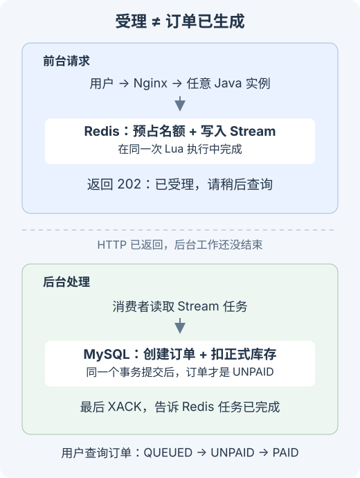

> 2026 年 9 月更新：补充可运行的 order-seckill-demo、真实 MySQL 8 / Redis 8 实验和压测记录。源码与压测脚本见文末说明。

在[上一篇订单实验](/posts/order-demo/)里，我们用内存模拟库把防重、条件扣库存、取消回滚和事务边界讲通了。

但回到现实生产环境，如果同一秒涌入几千个并发争抢同一件秒杀商品，即便你的 SQL 写得极其严密（`WHERE available >= count`），系统依然会秒崩。

原因很简单：**所有事务都在疯狂争抢同一行数据的行级排他锁（X 锁）**。前一个事务没提交，后面的几千个线程就全卡在 MySQL 的锁等待队列里。HikariCP 连接池迅速耗尽，Tomcat HTTP 工作线程全部打满，外层请求疯狂超时转圈——哪怕最终数据库只扣了 100 件库存没超卖，系统也早被这波流量冲垮了。

这次我们搭建独立的 `order-seckill-demo`，接入真实 Docker MySQL 8 和 Redis 8，用压测脚本实测从「纯同步落库」到「限流保护」，再到「Redis Lua 预占 + Stream 异步削峰」的演化全过程。

---

## 阶段推演与系统架构

实战分为三个对照阶段：

1. **阶段一（纯同步下单）**：请求直通 MySQL，在同一个事务内完成防重校验、行锁扣减与订单插入。
2. **阶段二（同步 + 固定窗口限流）**：进入数据库事务前，利用 Redis 统计请求频次，超额直接拦截返回 429。
3. **阶段三（Redis Lua 预占 + 异步落单）**：
   - **请求入口**：执行一段 `reserve.lua`，原子完成资格检查、防刷拦截、Redis 预占库存扣减并向 Redis Stream 推送下单事件，耗时仅需几毫秒；
   - **后台消费**：后台 `Worker` 线程按数据库能承受的速率平稳拉取 Stream 任务，批量落库并在提交后显式 `XACK`；
   - **回补补偿**：未付款超时取消时，通过本地 `release_outbox` 事务性保证 MySQL 与 Redis 两份库存最终一致。

---

## 一、先看纯同步扣减：账是对的，为什么瞬间崩盘？

### 1.1 条件扣减与事务实现

在 `Orders.java` 中，下单核心逻辑跑在 Spring 的 `TransactionTemplate` 内部：

~~~java
transactionTemplate.execute(status -> {
    // 1. 尝试插入订单记录（利用 activity_id + user_id 唯一约束防刷）
    long inserted = orderRepo.insertIgnore(activityId, userId, requestId);
    if (inserted == 0) return orderRepo.findByUser(activityId, userId);

    // 2. 核心原子扣减 SQL：在更新的同时做前置判断
    int updated = database.jdbc.update("""
        UPDATE activity
        SET available = available - 1, locked = locked + 1
        WHERE id = ? AND available > 0
        """, activityId);

    if (updated == 0) {
        status.setRollbackOnly();
        return OrderResult.soldOut();
    }
    return orderRepo.markUnpaid(requestId);
});
~~~

这个写法的逻辑完全闭环：
- `INSERT IGNORE` 配合 `UNIQUE KEY (activity_id, user_id)` 挡住单用户连击；
- `UPDATE ... WHERE available > 0` 保证绝不超卖。

### 1.2 瓶颈所在：行锁热点与连接池雪崩

我们给服务配置了标准的生产规格：每个实例最多 8 个数据库连接、64 个 HTTP 工作线程。

当并发达到 600 QPS 时：
- MySQL 针对这唯一一行 `activity` 施加行锁。每个事务在执行 `UPDATE` 后，必须等 Java 业务代码把订单状态改完并完成提交，锁才会释放；
- 单个事务耗时哪怕只有 10ms，一秒钟这一行记录顶破天也只能串行处理约 100 次事务；
- 剩下的 500 个并发请求全部堵在连接池借出队列中，导致 HTTP 线程池在几十毫秒内被全部占死，服务直接对外假死。

---

## 二、第一道补丁：固定窗口限流

既然数据库每秒只能抗约 100 单，最暴力的自保手段就是在进入 MySQL 之前踩刹车：

~~~lua
local count = redis.call('INCR', KEYS[1])
if count == 1 then
  redis.call('EXPIRE', KEYS[1], 1)
end
return count
~~~

如果当前 1 秒窗口内计数值超过阈值（如 80），直接在 Controller 层抛出 HTTP 429 `LIMITED`，根本不让多余的请求触碰数据库连接池。

**实测结果**：
限流确实保住了数据库不被拖垮。但它的代价是**硬性粗暴拒绝**：
- 很多想买的用户直接被当头一棒拒之门外；
- 固定窗口切换瞬间存在突刺问题，成功落单请求的 P95 依然居高不下（约 650ms）。

限流是“防御武器”，并没有解决“突发流量排队缓冲”的体验问题。

---

## 三、第二道重构：Redis Lua 预占与 Stream 异步削峰

要想让接口在几十毫秒内响应数千并发，唯一的生路就是**将落库由同步转为异步，由 Redis 充当第一道库存防线**。

### 3.1 为什么不能用简单的 `DECR`？

很多教程讲秒杀直接写 `redisTemplate.opsForValue().decrement(stockKey)`，这在生产上漏洞百出：
1. 没有校验活动是否已经开始或结束；
2. 没有拦截同一用户的并发重复点击（幂等防重）；
3. 扣完 Redis 之后如果 Java 进程崩溃，往 MQ 推消息失败，Redis 库存直接白白蒸发（少卖）；
4. 没有判断队列积压深度，任由后台无限堆积。

这些操作必须具备强原子性，必须由一段 Lua 脚本在 Redis 内部一气呵成完成。

### 3.2 核心 `reserve.lua` 原子设计

~~~lua
-- reserve.lua 核心片段
local activityKey = KEYS[1]
local userKey     = KEYS[2]
local streamKey   = KEYS[3]

local userId    = ARGV[1]
local requestId = ARGV[2]
local actId     = ARGV[3]

-- 1. 用户防重检查
local existing = redis.call('HGET', userKey, userId)
if existing then
    return {'DUPLICATE', existing}
end

-- 2. 积压深度熔断：超过 maxBacklog 立即拒绝，防止消费者永久追不上
local backlog = tonumber(redis.call('HGET', activityKey, 'backlog') or '0')
local maxBacklog = tonumber(redis.call('HGET', activityKey, 'max_backlog') or '500')
if backlog >= maxBacklog then
    return {'BUSY', ''}
end

-- 3. 检查并扣减预占库存
local available = tonumber(redis.call('HGET', activityKey, 'available') or '0')
if available <= 0 then
    return {'SOLD_OUT', ''}
end

-- 4. 原子执行：扣库存、增积压、记用户、推 Stream 待办
redis.call('HINCRBY', activityKey, 'available', -1)
redis.call('HINCRBY', activityKey, 'backlog', 1)
redis.call('HSET', userKey, userId, requestId)
redis.call('XADD', streamKey, '*', 'activity', actId, 'user', userId, 'request', requestId)

return {'ACCEPTED', requestId}
~~~

这段脚本彻底封死了所有时序缝隙：
- **库存预占与入队同生共死**：扣减库存与向 Stream 推送任务在同一个 Redis 事务周期完成，绝不可能发生“库存扣了但任务丢失”；
- **自适应过载保护**：通过 `backlog` 严格限制待办上限，超过直接返回 `BUSY`，不再盲目接单。

---

## 四、消费端稳健落库与故障自愈

### 4.1 消费与提交时序

后台 `Worker.java` 监听 Redis Stream 消费组：

~~~text
拉取 Stream 任务 (XREADGROUP)
   ↓
开启 MySQL 事务落单 (唯一约束保证幂等)
   ↓
提交数据库事务
   ↓
向 Redis 执行确认 (ack.lua: XACK 并原子递减 backlog 计数)
~~~

**时序绝对不能颠倒**：如果先 `XACK` 再写 MySQL，一旦写库前夕进程崩溃，这笔任务就成了永远丢失的孤儿。

反过来，若写库成功但在调用 `XACK` 前夕容器挂了，重启后该任务会留在 Stream 的 `PEL`（Pending Entries List）中。另一个消费者实例会重新认领它，凭借 MySQL 唯一索引，更新直接幂等忽略，随后补调 `XACK` 即可平滑自愈。

### 4.2 认领死信（XPENDING 恢复机制）

当某个 Java 实例意外崩溃时，它领走但未确认的消息会一直停在 Pending 列表。

后台守护线程定期巡检：
~~~java
// 扫描空闲超过 3 秒的未确认消息，重新认领消费
List<MapRecord<String, Object, Object>> pending = redis.opsForStream()
    .pending(streamKey, groupName, Range.unbounded(), 20);
for (var p : pending) {
    if (p.getElapsedTime().toSeconds() > 3) {
        // 重新拉取并重做业务落单
    }
}
~~~

---

## 五、库存归还与双写一致性对账

### 5.1 订单取消与回补两难

用户如果超时未付款或主动取消，MySQL 端的可用库存加一，Redis 端的预占库存也必须加一。

**分布式两阶段更新的致命问题**：
如果直接在 Java 代码里先 `update MySQL`，再调用 `redis.eval(release.lua)`，一旦此时网络超时或 Redis 挂掉，MySQL 释放了库存，Redis 却漏加了，导致后续用户再也抢不到这件库存。

### 5.2 解决方案：本地事务写 `release_outbox`

利用本地事件表彻底解耦：
~~~sql
-- 同一个本地事务内完成：
UPDATE activity SET available = available + 1, locked = locked - 1 WHERE id = ?;
UPDATE orders SET status = 'CANCELLED' WHERE request_id = ?;
INSERT INTO release_outbox (activity_id, request_id, count, status) VALUES (?, ?, 1, 'INIT');
~~~

后台专用调度器负责异步扫表，调用 `release.lua` 幂等增加 Redis 库存，确认成功后再物理删除该 outbox 记录。这样即便 Redis 临时宕机半小时，恢复后也能全量自动对齐。

---

## 六、全量压测实测与数据剖析

我们使用 Python 压测脚本，针对统一的 Nginx 入口发起阶梯压力测试（容器各限制 1 CPU、448MB 内存，压测发压持续 5 秒，共发 3000 请求）：

~~~bash
python3 scripts/benchmark.py --rates 100,300,600 --seconds 5 --repeats 2
~~~

### 6.1 目标 600 QPS 冲击下的实测对比

| 阶段 | 压测发出的请求数 | 客户端连接丢弃 | 接口 P95 响应时间 | 最终成功落单数 | 队列全部排空耗时 |
| :--- | :--- | :--- | :--- | :--- | :--- |
| **1. 纯同步下单** | 3000 | **2360 次丢弃** | **965 ms** | 640 单 | 0s（同步阻塞） |
| **2. 同步 + 限流 80** | 3000 | 0 次（全接收） | 415 ms (含429) | 400 单 | 0s |
| **3. Redis 预占 + 异步** | 3000 | **0 次丢弃** | **12.4 ms** | **3000 单** | **约 31 秒** |

### 6.2 数据深度解读

1. **同步下单彻底被打爆**：
   在 600 QPS 冲击下，由于 MySQL 行锁阻塞，HikariCP 队列瞬间爆满，压测客户端有 **78% 的请求直接因连接耗尽被客户端拦截丢弃**。勉强发进服务端的请求，P95 恶化到逼近 1 秒（965ms）。
2. **限流能够自保，但没有弹性**：
   限流阶段 2600 次请求直接被快速掐死返回 429。落单率被死死按在 80 单/秒。系统没挂，但也谈不上支撑高并发。
3. **异步削峰的本质是“以时间换空间”**：
   在异步模式下，3000 次请求全部在 **12ms 左右** 极速拿到 `ACCEPTED` 响应。这 3000 笔订单随后在 Redis Stream 中排队，后台 Worker 稳定按 **96 单/秒** 的恒定速率写入 MySQL，并在 **31 秒内** 全部排空落库。

> **核心结论**：
> 削峰填谷从来不是“把 MySQL 写入速度提升了几十倍”，而是**利用 Redis 的内存吞吐接住瞬时海量冲击，把前端必须承受的连接排队，转化为后台可控的稳健任务消化**。
