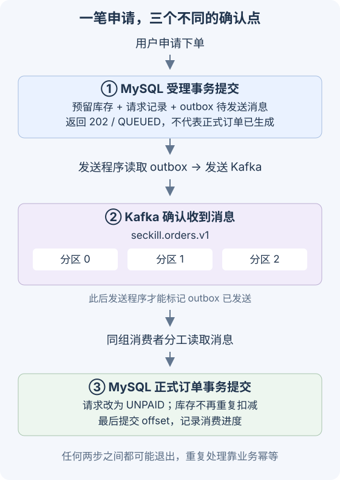

> 2026 年 9 月更新：使用 Kafka 4.1.2 重做实验，补充 Docker 配置、Java 源码与故障恢复实测。源码已发布至 GitHub：[Jayczee/order-seckill-kafka-demo](https://github.com/Jayczee/order-seckill-kafka-demo)。

在[上一篇秒杀实验](/posts/order-seckill-demo/)里，我们通过 Redis 预占把无效流量挡在了数据库之外，并将落单请求塞进了异步队列。当时为了图省事，异步队列用的是 Redis List / Stream。

单机实验跑着挺欢，但在真实生产或微服务架构下，Redis 当 MQ 的缺陷非常明显：
1. **横向扩展与并发受限**：Redis 不具备 Kafka 原生的分区（Partition）与消费组（Consumer Group）弹性负载均衡机制，多实例分流处理很别扭；
2. **可靠性与持久化代价高**：Redis 内存寸土寸金，堆积几十万消息代价极高，且无法像 Kafka 那样依靠磁盘顺序写做低成本海量缓冲与位移回溯；
3. **容错机制薄弱**：业务处理异常时，缺乏标准的重试回退、死信队列（DLT）流转和毒丸消息隔离手段。

这次我们老老实实接上独立的消息中间件 Kafka。实验采用官方最新的 **Kafka 4.1.2** 容器镜像——基于纯 **KRaft** 架构，彻底告别了 ZooKeeper 的历史包袱。

核心目标是实现一条秒杀请求的可靠落单闭环：**HTTP 受理 -> 事务性 Outbox 固化 -> Kafka 幂等投递 -> 消费者可靠落单 (Manual ACK) -> 失败重试与死信兜底**，并顺带记录下分布式消息链路里那些极易翻车的硬坑。

---

## 链路拓扑与架构状态机

将“用户下单”拆成异步链路后，整个流程的本质是**三次状态确认的分离**：

~~~text
[用户请求] 
    ↓
1. HTTP 受理 (MySQL 事务)
   ├── 扣减 activity 可用库存、增加 locked 库存
   ├── 插入 requests 表 (状态: QUEUED)
   └── 写入 outbox 待发任务 (同一事务保证不丢单)
    ↓
2. Outbox 轮询分发 (租约机制 + SKIP LOCKED)
   └── 发送消息至 Kafka Topic: seckill.orders.v1 (生产者 acks=all + idempotence)
    ↓
3. Kafka 消费落单 (Spring Kafka @KafkaListener)
   ├── MySQL 事务：创建正式 orders 表记录，更新 request 状态为 UNPAID
   └── 成功后手动提交 Offset (Manual Immediate Ack)
       └── 若重试超限：转入 seckill.orders.v1.DLT 并标记 MANUAL_REVIEW
~~~

---

## 一、Docker 编排：纯 KRaft 模式的 Kafka 4.1.2

在 4.0 之后，Kafka 官方正式移除了对 ZooKeeper 的支持，元数据完全由内置的 KRaft Controller Quorum 自主选举与维护。

### 1.1 Compose 编排核心配置

在单节点实验环境中，一个 Kafka 进程同时兼任 `broker`（收发业务消息）与 `controller`（集群元数据管理）：

~~~yaml
services:
  kafka:
    image: apache/kafka:4.1.2
    environment:
      KAFKA_NODE_ID: 1
      KAFKA_PROCESS_ROLES: broker,controller
      KAFKA_CONTROLLER_QUORUM_VOTERS: 1@kafka:9093
      CLUSTER_ID: "MkU3OEVBNTcwNTJENDM2Qk"
      KAFKA_LISTENERS: INTERNAL://:9092,CONTROLLER://:9093,EXTERNAL://:19092
      KAFKA_ADVERTISED_LISTENERS: INTERNAL://kafka:9092,EXTERNAL://${KAFKA_EXTERNAL_HOST:-localhost}:19092
      KAFKA_LISTENER_SECURITY_PROTOCOL_MAP: INTERNAL:PLAINTEXT,CONTROLLER:PLAINTEXT,EXTERNAL:PLAINTEXT
      KAFKA_INTER_BROKER_LISTENER_NAME: INTERNAL
      KAFKA_CONTROLLER_LISTENER_NAMES: CONTROLLER
      KAFKA_OFFSETS_TOPIC_REPLICATION_FACTOR: 1
      KAFKA_TRANSACTION_STATE_LOG_REPLICATION_FACTOR: 1
      KAFKA_TRANSACTION_STATE_LOG_MIN_ISR: 1
    volumes:
      - kafka-data:/var/lib/kafka/data
~~~

### 1.2 最经典的深坑：连得上端口，为什么一发消息就超时？

新手接入 Kafka 最常踩的坑：**混淆了 `listeners` 与 `advertised.listeners`**。

- `listeners`：Kafka 进程在宿主机/容器内真正监听哪几个网络端口；
- `advertised.listeners`：**Kafka 向客户端“公布”的元数据地址**。

Kafka 的握手流程是：客户端首先连接 bootstrap-server 发起探测，Kafka 收到后并不会直接在当前通道传输所有消息，而是将集群元数据（当前分区 Leader 的 advertised 地址）返回给客户端，要求客户端**按照这个新地址重新建连**！

- 如果你在 Docker 容器内部调用，使用的地址是 `INTERNAL://kafka:9092`；
- 如果你在宿主机（或通过 NAS 局域网）连接，Kafka 必须返回宿主机能访问的 IP（如 `${KAFKA_EXTERNAL_HOST:-localhost}:19092`）。如果这里漏配或填错成容器内网 IP，宿主机哪怕能 telnet 握手端口，发消息时也会报 `TimeoutException: Expired 1 batches in ... ms: metadata update failure`。

启动集群与 MySQL：

~~~bash
bash scripts/init-secrets.sh
docker compose up -d mysql kafka
docker compose ps
~~~

---

## 二、消息生产端设计：事务性 Outbox 与幂等保证

### 2.1 为什么不能在 HTTP 请求里直接调用 `kafkaTemplate.send()`？

很多初学者容易写出这样的代码：
~~~java
@Transactional
public void buy(String userId, String sku) {
    stockRepo.decreaseAvailable(sku); // 1. 扣库存
    kafkaTemplate.send("orders", new OrderEvent(...)); // 2. 发消息
}
~~~
这是典型的伪可靠架构：
- 场景 A：Kafka 刚好发生网络抖动或 Leader 重新选举，`send()` 阻塞或抛异常，导致已经成功的数据库库存事务被动回滚；
- 场景 B：`send()` 执行成功，但事务在 `commit` 阶段因为数据库死锁或网络异常崩溃，导致 Kafka 消息已经发出去了，数据库里却根本没有这笔申请！

**本地数据库事务无法将外部网络 I/O 纳入同一个原子边界。**

### 2.2 事务性 Outbox 模式落地

解决方案是**事务性 Outbox（发件箱）模式**：在 MySQL 本地事务中，不仅扣减库存，还顺带往一张名为 `outbox` 的本地待发任务表里插入一条记录：

~~~java
// OrderService.java 核心落单受理事务
transactionTemplate.execute(status -> {
    int updated = stockRepo.lockStock(activityId, 1);
    if (updated == 0) throw new SoldOutException();
    
    requestRepo.insert(requestId, userId, activityId, "QUEUED");
    outboxRepo.insert(requestId, "seckill.orders.v1", eventJson);
    return null;
});
~~~

这样，只要库存扣减成功，待发送任务就 100% 固化在 MySQL 磁盘上。进程哪怕此时被拔电源，重启后任务依然在。

### 2.3 基于 `FOR UPDATE SKIP LOCKED` 的租约分发

后台异步调度器 `OutboxPublisher` 定时拉取待发任务：

~~~java
@Scheduled(fixedDelay = 100)
public void publish() {
    // 短事务利用 SKIP LOCKED 争抢待发任务，并施加 30 秒租约
    List<OutboxTask> tasks = outboxRepo.claimTasksWithLease(batchSize = 20, leaseSeconds = 30);
    for (var task : tasks) {
        try {
            kafkaTemplate.send(task.topic(), task.requestId(), task.payload())
                         .get(10, TimeUnit.SECONDS);
            outboxRepo.markSent(task.id()); // 成功后硬标记
        } catch (Exception e) {
            log.warn("发送失败，保留待办等租约过期后重试: {}", task.requestId(), e);
        }
    }
}
~~~

使用 `FOR UPDATE SKIP LOCKED` 的精妙之处在于：多个实例并发扫描 outbox 表时，每个实例只锁定自己抢到的记录，被锁定的行会被其他事务自动跳过，完全不会发生行级锁争用。

### 2.4 生产者级别幂等与重试配置

在 `application.properties` 中开启 Kafka 原生幂等性：

~~~properties
spring.kafka.producer.acks=all
spring.kafka.producer.properties.enable.idempotence=true
spring.kafka.producer.properties.max.in.flight.requests.per.connection=5
spring.kafka.producer.properties.delivery.timeout.ms=10000
spring.kafka.producer.properties.request.timeout.ms=3000
~~~

- `acks=all`：Leader 副本必须等到全部 In-Sync Replicas (ISR) 写入成功才返回确认；
- `enable.idempotence=true`：客户端为每个 Producer 分配唯一 PID，为每条消息分配递增 Sequence Number。Broker 端自动拦截重试导致的重复消息，彻底杜绝单条连接内的网络重复投递。

---

## 三、消费端核心：Manual ACK、重平衡与业务幂等

### 3.1 消费位移提交策略（Offset Commit）

默认的自动提交（`enable-auto-commit=true`）在生产高并发下极不靠谱：它是在后台按定时器提交位移，如果消费者刚拉到消息但业务落单还没写进 MySQL 进程就挂了，未落单的消息就会永久丢失。

我们必须采用手动提交机制：

~~~properties
spring.kafka.consumer.enable-auto-commit=false
spring.kafka.listener.ack-mode=manual_immediate
~~~

在监听器中严格把控操作时序：**必须等 MySQL 订单落盘成功后，才能调用 `ack.acknowledge()`！**

~~~java
// OrderConsumer.java
@KafkaListener(id = "order-worker", topics = "seckill.orders.v1")
public void consume(ConsumerRecord<String, String> record, Acknowledgment ack) throws Exception {
    OrderEvent event = json.readValue(record.value(), OrderEvent.class);
    
    // 1. 本地数据库写正式订单（含业务幂等校验）
    orders.materialize(event, record.partition(), record.offset());
    
    // 2. 成功后立即显式向 Kafka 提交当前位移
    ack.acknowledge();
}
~~~

### 3.2 业务级幂等：为什么只防网络重复还不够？

Kafka 自身的幂等性仅限于单 Producer 会话周期内的瞬时网络抖动。如果消费者写完 MySQL 订单后、正准备调用 `ack.acknowledge()` 的瞬间断电，Kafka 记录的 offset 仍是旧的。服务重启后，这条消息必然会被重新投递一次。

因此消费端必须具备**业务防重能力**：
1. `orders` 表对 `(activity_id, user_id)` 建立唯一复合索引；
2. 在 `materialize` 内部使用防重逻辑：如果该 `requestId` 已经落过单，直接忽略并返回成功，绝不二次扣减或生成脏单。

---

## 四、容错进阶：毒丸消息与死信队列（DLT）

如果一条消息因为格式畸形或业务死锁，导致消费线程无论重试多少次都必定抛出异常，整个分区的消费进度就会被死死卡住。

### 4.1 死信路由（Dead-Letter Publishing）

在 `KafkaConfig.java` 中利用 Spring Kafka 提供的 `DefaultErrorHandler` 配置重试与死信熔断：

~~~java
@Bean
public CommonErrorHandler errorHandler(KafkaTemplate<String, String> kafkaTemplate) {
    // 超过重试上限后，将失败消息路由至 [原topic].DLT，并保持原分区编号
    var recoverer = new DeadLetterPublishingRecoverer(kafkaTemplate,
            (record, exception) -> new TopicPartition(record.topic() + ".DLT", record.partition()));
    recoverer.setFailIfSendResultIsError(true);
    recoverer.setWaitForSendResultTimeout(Duration.ofSeconds(15));
    
    // 固定重试 2 次，每次间隔 1000ms（共尝试 3 次）
    var handler = new DefaultErrorHandler(recoverer, new FixedBackOff(1000, 2));
    handler.setCommitRecovered(true); // 成功投递至死信后，允许推进原 Topic 的 Offset
    return handler;
}
~~~

### 4.2 人工兜底与重放机制

系统单独配置一个消费者监听 `seckill.orders.v1.DLT`：
1. 捕获死信后，将错误堆栈与消息载荷完整沉淀到 MySQL `failed_message` 表；
2. 将对应申请置为 `MANUAL_REVIEW`，占用库存依然保留，避免误释放；
3. 后台提供人工排查接口，在修复代码或脏数据后，调用 `/replay` 生成一条新的 outbox 任务重新投递，避免人工去人肉修改 Kafka Offset。

---

## 五、压测、积压削峰与故障自愈实测

### 5.1 创建 Topic 并启动服务

执行脚本创建订单与死信 Topic（各 3 分区）：

~~~bash
bash scripts/topics.sh
mvn -B -ntp package
docker compose up -d --build app1 app2 gateway
~~~

验证基础连通性：

~~~bash
curl http://127.0.0.1:18380/health
python3 scripts/lab.py hello
~~~

### 5.2 削峰验证：人为暂停消费观察 Lag

为了肉眼观察 Kafka 的缓冲削峰能力，运行 `scripts/queue-lab.py`：
1. 脚本通过 JMX/REST 临时暂停两个实例的消费监听器（模拟下游订单系统处理不过来）；
2. 短时间内涌入 60 笔下单申请；
3. 检查 Kafka 分区状态：

~~~bash
docker compose exec -T kafka /opt/kafka/bin/kafka-consumer-groups.sh \
  --bootstrap-server kafka:9092 \
  --describe --group order-writer-v1
~~~

此时终端输出中清晰可见三个分区的 `LAG` 堆积为 `22 / 19 / 19`（合计 60），MySQL 端正式订单数为 0；

随后恢复消费监听器，两个消费者实例全速拉取消化，各自分配的分区 Lag 迅速归零，MySQL 正式订单数精确达到 60 笔。

### 5.3 故障注入与回归矩阵

运行自动化验证套件 `python3 scripts/verify.py`，执行全量破坏性实验：

| 故障场景 | 验证断言 | 实测结果 |
| :--- | :--- | :--- |
| **超卖对抗** | 300 个并发争抢 100 件库存 | 最终正好生成 100 笔订单，库存不为负 |
| **高频重放** | 同一用户 60 次并发重复抢购 | 唯一约束拦截，只生成 1 笔真实订单 |
| **并发取消与支付** | 同一订单同时发起付款与取消 | 状态机竞争保证互斥，库存流转零偏差 |
| **Kafka 确认前进程崩溃** | Outbox 发送中断 | 30 秒租约到期后另一实例捡起重发，订单数精确一致 |
| **写库成功后 Offset 提交前崩溃** | 消费者重启收到重复消息 | 幂等逻辑直接拦截，不二次扣减库存 |
| **毒丸消息注入** | 故意抛出致命业务异常 | 3 次重试后平滑转移至 DLT，原分区无阻塞 |
| **Kafka 宕机中断** | 直接 `docker stop kafka` 后继续下单 | 受理申请稳固沉淀在 MySQL Outbox，Kafka 恢复后全量自愈补发 |

各项断言全部通过。

---

## 六、生产部署核心差异备忘

在将本 Demo 迁往真实多节点生产集群前，记牢以下几个红线差异：

1. **单机副本为 1 没有任何容灾意义**：生产必须采用 `replication-factor: 3` 与 `min.insync.replicas: 2`，保证即便挂掉一台 Broker，写入依然安全；
2. **Controller 独立奇数部署**：KRaft 的控制器建议由 3 台或 5 台专用节点组成 Quorum 集群，与高负载的 Broker 进程物理隔离；
3. **`max.poll.interval.ms` 监控**：单批拉取的消息处理耗时严禁超过该配置（默认 5 分钟），否则 Broker 会判定消费者已假死并触发强制 Rebalance，引发消息反复重复消费；
4. **安全加固**：生产集群必须配置 SASL/SCRAM 认证与 TLS 双向加密通信，禁止裸露 PLAINTEXT 端口。
