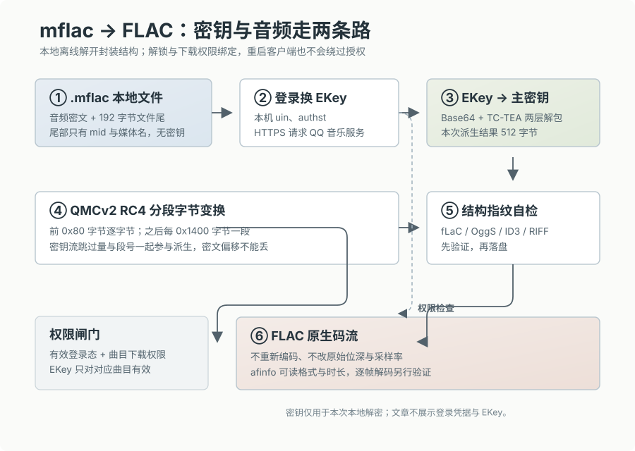

> 本文仅记录个人在 Mac 上备份已下载音频的技术分析与算法实现，不提供打包工具或解密分发服务。

把 Mac 版 QQ 音乐下载的一批无损音频拷贝到车载播放器或者 NAS 时，会发现文件全是以 `.mflac` 结尾。如果直接把扩展名改成 `.flac`，播放器会直接报错退出。

拿十六进制编辑器看一眼文件头，前几个字节不是 FLAC 规范的 `fLaC`（`0x66 0x4C 0x61 0x43`），而是一堆毫无规律的二进制数据。显然，音频本体已经被加密了。

早期的 QMC 格式基本是静态离线异或，把整轨数据跑一遍固定的 mask 就能还原。但在现在的客户端上，这套思路已经彻底行不通了：音频数据被分块重新处理过，而且**文件本地根本没有解密密钥**。

为了把下载的 67 首无损还原为标准 FLAC，我花时间把客户端的数据流和加密链条逆向梳理了一遍。整理下来发现，QQ 音乐这套本地 DRM 的工程设计相当有讲究——特别是它在文件尾追加数据的方式，以及为了播放器寻道性能而设计的 RC4 分段机制。



---

## 为什么加密文件要在屁股后面加一串东西？

很多人第一反应会好奇：**“既然加密是把音乐变成乱码，为什么 QQ 音乐还要在每个文件末尾硬塞进去 192 个字节？”**

直觉上，常见的文件格式（比如 MP4、MKV、ID3v2）都喜欢把元数据和描述信息写在文件头部。但 QQ 音乐在本地落盘时，文件结构其实长这样：

```text
+-------------------------------------------------------------+-------------------------+
|                  Encrypted Audio Payload                    |      PcV2MusicEx        |
|                  (QMCv2 RC4 5120 字节分段密文)                |     (固定 192 字节尾部)   |
+-------------------------------------------------------------+-------------------------+
0                                                          EOF-192                     EOF
```

前面 99.9% 的体积是完全加密的音频流，只有最后紧贴文件尾的 192 字节，是名为 **`PcV2MusicEx`** 的结构体。

为什么不把这串信息放开头，而要放在尾部？这里面有两个很实际的工程考虑：

### 1. 流式下载与磁盘写入效率（$O(1)$ 追加）
音乐客户端在下载歌曲时，底层往往是基于 HTTP Range 分片并发拉取，或者边下边播（Streaming）。在流式拉取过程中，音频数据是源源不断往磁盘文件写入的。

如果元数据放在文件头部，客户端在下载前就必须精确预留出头部空间。万一歌曲下载完、校验完才生成这笔本地标识，要把信息塞到文件开头，操作系统就必须把整首几十兆甚至上百兆的文件在磁盘上整体往后搬移（Memmove），产生大量无效的磁盘 I/O。

而在文件末尾追加数据，只需要做一次 `seek(0, SEEK_END)` 然后直接 `write()`，时间复杂度是极其轻量的 $O(1)$。

### 2. 秒级废掉第三方播放器
任何音频播放器在读取一个文件时，第一件事都是读取 offset 0 的前 4 到 16 个字节来嗅探格式（MIME Sniffing）。

QQ 音乐直接把从第 0 字节开始的音频正文全量加密，播放器扫一眼头部发现不认识，就会立刻放弃解析。用户就算想靠“改文件扩展名”蒙混过关，也根本播不出来。

### 尾部的 192 字节到底写了什么？

用十六进制查看文件最后 192 字节（小端序长度 `0xC0000000` = 192）：

```text
00000240: a9bf 0e7b 5467 a9c9 d396 e3e6 c245 f632  ...{Tg........E.2
00000250: ee41 3a0b 6f19 0d3a b5da 0600 0200 0000  .A:..o..:.......
00000260: 0a00 0000 3000 3000 3300 6100 4100 5900  ....0.0.3.a.A.Y.
...
00000270: 6d00 7500 7300 6900 6300 6500 7800 00    m.usicex.
```

结尾清晰可见 UTF-16LE 编码的 `musicex\0` 字符串。把这 192 字节拆解开，主要包含两部分核心信息：
* 该歌曲的媒体标识 `mid`（例如 `003aAY...`）；
* 本地下载时对应的媒体缓存文件名，形如 `Q0M0003nPURu1GX6e5.mflac`。

**这 192 字节里没有任何密钥。** 它不是防盗锁本身，而是贴在门上的**“取件码”**。

这也就意味着，老式的脱机离线解密工具之所以全部失效，是因为现在的 `.mflac` 本身根本不包含解密密码。想要这把钥匙，必须拿着取件码回服务端去换。

---

## 密钥获取：在 macOS 偏好设置中提取会话凭证

官方客户端在播放本地加密文件时，只要用户处于登录状态，就能在后台自动向服务接口换取该单曲的加密密钥（`EKey`）。

既然官方客户端能换，就说明相关的登录态凭证一定保存在本地。

在 Windows 上，这些信息通常存在注册表或 AppData 目录；而在 macOS 环境下，QQ 音乐的落盘路径有明确的分工：

* **音频文件沙盒路径**：
  ```text
  ~/Library/Containers/com.tencent.QQMusicMac/Data/Library/Application Support/QQMusicMac/iQmc
  ```
* **用户登录凭据路径**：
  ```text
  ~/Library/Preferences/com.tencent.QQMusicMac.plist
  ```

用 Python 的 `plistlib` 模块直接解析这个 `.plist` 文件，在 `AutoLoginUserInfo` 节点下就能直接拿到两个关键凭证：
1. `uin`：当前登录账号的 QQ/用户号；
2. `authst`：当前有效的认证票据（Session Ticket）。

有了 `uin` 和 `authst`，再加上从文件尾那 192 字节中读出来的 `mid` 与媒体文件名，向 QQ 音乐的密钥交换端点发送请求，服务端就会返回一段 Base64 编码的密文，这就是该曲目对应的 **`EKey`**。

拿到 EKey 后可以在本地写入缓存（如 `~/Library/Caches/qqmusic-decrypt/ekey_cache.json`），同一首歌后续再跑解密就完全不需要重复发起网络请求了。

---

## 密钥派生：TC-TEA（TEA-CBC）双层拆包

拿到的 `EKey` 是一长串 Base64 字符串。直接解码之后依然不能拿来解密音频，因为腾讯用自己的 **TC-TEA（基于 16 字节密钥的 TEA-CBC 变种）** 算法在外面包了壳。

这一步的作用是防抓包和防重放：即使有人在网络层截获了传输中的 EKey，也无法直接知道内存中运算的主密钥是什么。

拆包流程有两层：
1. **外层解密**：Base64 解码后，如果发现头部带有 `QQMusic EncV2,Key:` 字符串，使用客户端内置的两组固定 TEA 密钥连续进行 CBC 解密，剥离外层；
2. **内层解密**：从外层解出的载荷中截取前缀字节，与预置的魔数常量表进行按字节交错运算，拼装出一组动态的 16 字节 TEA 密钥；用这组密钥二次解密内层载荷，最终得到解密音频用的原始主密钥。

解出来的原始主密钥长度通常是 **512 字节**。在 QMCv2 规范里，主密钥长度大于 300 字节时，音频解密引擎就会路由到 **RC4** 算法分支。

---

## 核心算法：QMCv2 为什么采用 5120 字节分段 RC4？

拿到 512 字节的主密钥后，最容易掉进的一个误区是：直接拿这个 Key 初始化一个标准 RC4，然后对着密文一路异或到底。

如果真这么做，解出来的音频前 128 字节是好的，后面立刻变成无法解码的刺耳噪音。

为什么？因为**流密码（Stream Cipher）如果连续运行，会直接杀死多媒体播放的随机寻道（Random Seeking）性能。**

### 播放器寻道的矛盾
RC4 本质上是一个伪随机数生成器（PRGA）。状态机每吐出一个字节，内部的 $S$ 盒状态就会演进一次。

如果一首歌有 60MB，用户随手拖动进度条到第 40MB 处：
* **如果是连续 RC4**：播放器为了算出第 40MB 的那个异或字节，必须让 RC4 状态机在内存里空转 40,000,000 次！这在播放高规格无损时会造成严重的 CPU 峰值和界面卡顿；
* **QMCv2 的分块设计**：它把音频流切成了固定大小的块，使得播放器跳到任何时间点时，只需要计算当前块内的极小偏移即可。

### 具体的分块规则

QMCv2 的实际处理逻辑如下：

1. **第 1 块（特殊头部）**：
   文件开头 `0x80`（128 字节）单独作为第一段，直接使用派生后的密钥流做逐字节异或。这 128 字节正好覆盖了 FLAC 的 `fLaC` 标识符和 `STREAMINFO` 元数据块。
2. **后续分块**：
   从第 129 字节开始，每 `0x1400`（5120 字节）划分为一个独立的 Block。
3. **分段跳过（Skip Offset）**：
   每个 Block 在开始异或之前，并不从密钥流的第 0 个字节开始取，而是根据：
   $$\text{skip} = (\text{block\_index} \times \text{seed} + \text{key\_hash}) \pmod{\text{window}}$$
   先让密钥流指针往前空跳过这一段距离，然后再取字节与当前块的密文异或。

只有把这个每 5120 字节切段重置、动态跳过偏移的机制还原，整首歌曲的每一个音频采样点才能准确无误地归位。

---

## 自动化还原与音频原生校验

把整条链路跑通后，用 Python 实现了一个轻量脚本（无需 ffmpeg，也不依赖第三方 C 扩展）：

1. 扫描 `iQmc` 目录下的 `.mflac` 文件；
2. 剥除尾部 192 字节的 `PcV2MusicEx` 结构，提取 `mid` 和媒体文件名；
3. 从本地 `com.tencent.QQMusicMac.plist` 读取登录凭据，请求服务端换取 `EKey`；
4. 跑 TC-TEA 双层解包，派生 512 字节 RC4 主密钥；
5. 执行 5120 字节分段 RC4 异或，输出还原后的音频文件。

```bash
python3 qmc2dec.py \
  "$HOME/Library/Containers/com.tencent.QQMusicMac/Data/Library/Application Support/QQMusicMac/iQmc" \
  -o "$HOME/Desktop/unlock" \
  --verbose
```

### 为什么选择 afinfo 验货？

解密脚本执行成功、前 4 个字节出现 `fLaC`，并不能 100% 说明整首歌完全解密正确。如果中间某个 5120 字节块的偏移算错，文件头虽然合法，但解码到出错帧时依然会爆音或中断。

在 macOS 上，系统自带了一个基于 CoreAudio 底层框架的命令行诊断工具：`afinfo`（Apple File Info）。它会真正去调用系统的解码器解包文件，只要音频帧有 CRC 校验错误、时间戳跳变或损坏，它就会返回非零状态码。

对解出的 67 首歌曲进行批量诊断：

```bash
for f in ~/Desktop/unlock/*.flac; do
  afinfo "$f" > /dev/null || echo "Decode error: $f"
done
```

扫描结果零报错，67 首全部顺利通过 CoreAudio 的底层解析。从提取出的流媒体属性来看：

```text
总曲目数：       67 首
总磁盘占用：     7237.9 MiB
音频总时长：     4 小时 41 分钟
```

| 音频规格 | 数量 | 采样细节 |
| :--- | :--- | :--- |
| **16-bit / 44.1 kHz** | 11 首 | 标准 CD 级母带（Bitrate ~850 kbps） |
| **24-bit / 48.0 kHz** | 18 首 | 高规格 Studio 录音室母带 |
| **24-bit / 192.0 kHz** | 38 首 | Hi-Res 顶级超高解析度音频（单曲体积 150MB+） |

抽查其中一首 192kHz/24bit 的文件输出：

```text
File type ID:            flac
Data format:             2 ch,  192000 Hz, flac (0x00000004) from 24-bit source
estimated duration:      278.120000 sec
audio bytes:             154823192
```

数据表明，整个解密过程完全是按原始字节流做逆运算，没有经过任何重新采样、重编码或有损转换，原盘的高规格动态范围被 1:1 地完整保留了下来。

---

## 结语

回顾 QQ 音乐这套本地保护方案，其实能清晰看到现代流媒体 DRM 的演进趋势：

1. **数据与凭证分离**：不在本地文件内固化全局密码，强依赖在线登录态去换取单曲 EKey，从根本上杜绝了单纯脱机写静态规则暴力破解的可能；
2. **兼顾多媒体吞吐性能**：利用尾部追加实现 $O(1)$ 的无感落盘，利用 5120 字节分段设计解决连续流密码无法快速寻道（Random Seek）的架构硬伤；
3. **验证闭环的重要性**：在逆向或处理私有媒体格式时，不能仅凭文件头或 exit code 下结论。借助操作系统原生的底层解码器（如 macOS 的 CoreAudio / `afinfo`）进行全流校验，才是检验文件是否真正还原的标准。

把导出的这批 FLAC 拷入 U 盘插入车机，曲目信息、高码率流以及内嵌封套均正常识别播放，整个链路的验证至此完整闭环。
