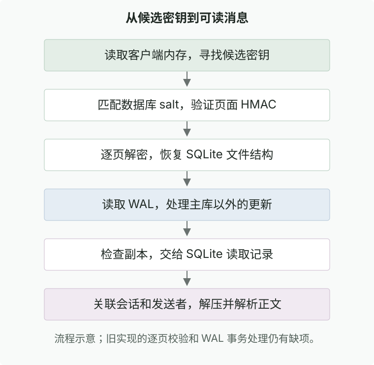
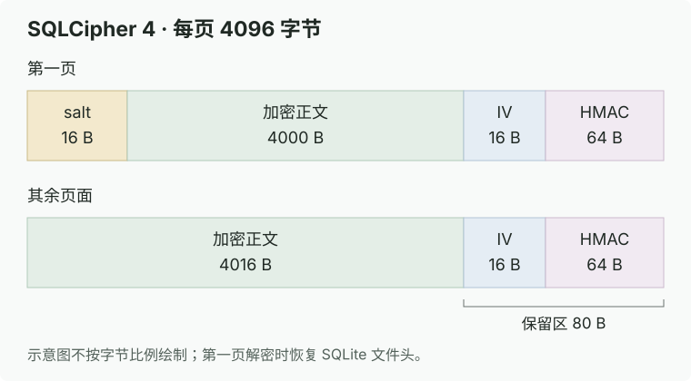

> 本文仅供技术原理学习交流，讨论的是获授权账号的本地数据。原项目 wechat-decrypt 已因 DMCA 下架，本文不提供源码或二进制下载，仅从逆向与数据库内核角度记录其解密管线。

前阵子在开发一个群聊分析工具时，需要把 Mac 微信本地的聊天记录同步到后台做检索和回溯。

把微信本地目录翻出来，找到一堆 `.db` 文件，以为直接用 SQLite 客户端就能连，结果直接报 `file is not a database`。

查了一下才发现，微信桌面端全量采用了 **SQLCipher**（基于 SQLite 源码改造的整页加密数据库）。之前 GitHub 上有个很火的项目 `wechat-decrypt`，能在微信运行时把本地库还原为标准 SQLite。现在原项目虽然被下架了，但其解密思路非常干净硬核，整理记录下来。

测试环境基于 Intel Mac、macOS 12.7.6，对应 Mac 微信 4.x（4.1.8）。

---

## 核心认知：不存在“暴力破解”，只有“内存探针”

很多外行一听“微信数据库解密”，以为是靠超级计算机穷举 AES 密钥，或者找微信加密算法的零日漏洞。

事实完全不是这样。最根本的逻辑在于：**只要微信登录后能在屏幕上正常显示聊天记录，微信进程在读取磁盘时就必须自己把数据解开。换句话说，解密所需的原始密钥，100% 毫无保留地躺在微信客户端的运行内存里。**

`wechat-decrypt` 的核心思路就两步：
1. **内存探针**：利用 macOS 系统的 Mach API 扫描运行中微信进程的虚拟内存，把驻留的 SQLCipher 密钥字符串捞出来；
2. **离线解密与格式修补**：对照 SQLCipher 页面规范逐页解密 AES-256-CBC，重构 SQLite 文件头与保留区，并追加合并 WAL 日志。

---

## 一、定位目标：微信本地存了哪些库？

微信本地数据按功能分成了多个独立 SQLite 数据库文件：
- **联系人库**：OpenID / WxID 映射到昵称、头像和备注；
- **会话库**：存储会话列表、置顶状态与未读数；
- **消息库（`message_*.db`）**：存放聊天正文、时间戳和发送者。消息量大时会自动切分到多个分库；
- **WAL 日志文件（`*.db-wal`）**：尚未 checkpoint 回主库的最新增量写入页面。

直接拿十六进制编辑器打开这些 `.db`，开头并不是熟悉的 `SQLite format 3\0`，而是随机字节流。这是因为 SQLCipher 在读写磁盘时，是以 4096 字节的“页（Page）”为单位整页加解密的。

---

## 二、内存特征搜索：如何从数 G 内存中捞出 Key？

### 2.1 内存特征模式

微信在打开 SQLCipher 数据库时，会将密钥以特定结构注入底层库。在 Mac 微信 4.x 中，内存里会留下一段极具辨识度的十六进制字符串：

~~~text
"32字节Hex加密密钥(64字符)" + "16字节Hex数据库Salt(32字符)"
~~~

总共是一段 96 个字符的十六进制文本。

扫描器并不是去暴力穷举 256 位的二进制随机数，而是**在内存里做正则/模式匹配**，直接检索符合这种 Hex 排列特征的候选内存块。

### 2.2 macOS Mach 虚拟内存遍历

在 macOS 上，工具通过 Mach 内核接口遍历目标进程的虚拟内存空间：
1. 调用 `task_for_pid()` 获取微信进程的 `mach_port`；
2. 使用 `mach_vm_region_recurse()` 递归遍历进程的所有内存段，筛选出具备可读权限的堆内存区（`VM_PROT_READ`）；
3. 分块读取内存并进行滑动窗口匹配。为了防止 96 字符的特征串恰好被跨内存分页截断，扫描块之间必须保留几十字节的重叠缓冲区（Overlap Buffer）。

---

## 三、精准匹配：如何确定 Key 属于哪个数据库？

内存里可能会抓出好几个候选 Key，怎么知道哪个 Key 对应哪个具体的 `.db` 文件？

答案藏在 **Salt（盐值）** 里：
- **加密数据库文件的最前 16 个字节，就是该库专属的明文 Salt**；
- 扫描器从内存中提取到的 96 字符里，后 32 字符正好是 16 字节的 Hex Salt。

只需读取磁盘上 `.db` 文件的前 16 字节，转换成 Hex 与内存候选串后半段比对：**Salt 一致，说明该 Key 准确对应当前数据库文件。**

---

## 四、逐页解密与 SQLite 格式逆向修补

SQLCipher 的页大小（Page Size）默认是 4096 字节。它并不是全局一次性流式加密，而是将每个 4096 字节的页面独立进行 AES-256-CBC 加密。

页面内部字节排布如下：

| 区域 | 第一页（Page 1） | 普通页（Page 2+） | 作用 |
| :--- | :--- | :--- | :--- |
| **页头偏移** | 16 字节 Salt | 无 | 存储数据库专属 Salt |
| **加密负载** | 4000 字节 | 4016 字节 | 真实 SQLite B-tree 数据载荷 |
| **页尾保留区** | 80 字节 | 80 字节 | 包含 16 字节 IV + 64 字节 HMAC |

### 4.1 HMAC 消息认证与密钥派生

为了防止数据篡改和校验 Key 的正确性，SQLCipher 在页尾嵌入了 64 字节的 HMAC-SHA512。

这里极易混淆的是：**解密用的 AES Key 和校验用的 HMAC Key 不是同一把！**
- **AES Key**：从内存拿到的 32 字节原始密钥；
- **HMAC Key**：对 Salt 每个字节异或 `0x3a` 后，与原始 Key 一起送入 PBKDF2（HMAC-SHA512，迭代 2 次）派生出的 32 字节专用 MAC 密钥。

每页的校验哈希由以下三部分拼接计算：
~~~text
HMAC-SHA512(HMAC_Key, [16字节IV] + [加密数据Payload] + [小端序4字节页号])
~~~
算出来的哈希与页尾保留区记录的值比对。第一页 HMAC 校验通过，才能 100% 确认该密钥和参数完全正确。

### 4.2 解密与 SQLite 文件头修补

对有效负载执行 AES-256-CBC 解密后，还必须做结构修复，否则 SQLite 引擎依旧打不开：

1. **补回魔数（Magic Header）**：
   标准 SQLite 数据库的前 16 字节必须是固定字符串：`SQLite format 3\0`。解密第一页后，必须将原本由 Salt 占据的前 16 字节强行覆盖回该标准魔数；
2. **保留区（Reserved Space）修正**：
   解密后的明文数据，页尾的 80 字节 IV/HMAC 可以填充为 `0x00`，但**绝不能把第一页偏移 105 处的 `reserved space` 字段改回 0**！因为内部 B-tree 节点偏移是按照 `4096 - 80 = 4016` 字节严格计算的，一旦把保留区声明抹掉，整个 B-tree 指针全部错位，数据库直接报结构损坏。

---

## 五、最新消息丢失之谜：处理 WAL 增量日志

把主 `.db` 成功解密后，经常会发现：**为什么刚刚聊完的最新几条消息查不到？**

这是因为 SQLite 默认开启了 **WAL（Write-Ahead Logging）模式**。客户端产生的新写入操作会先以 Frame 的形式追加到 `*.db-wal` 文件中，只有触发 Checkpoint 时才会合并刷回主数据库。

### 5.1 WAL 帧解密与覆盖

WAL 文件由 32 字节文件头和多个固定大小的 Frame 组成：
- 每个 Frame 包含 **24 字节 Frame Header** 和 **4096 字节加密页数据**；
- Frame Header 中包含了该帧对应的目标页号（Page Number）。

解密逻辑：
1. 逐帧读取 WAL 文件，校验 WAL 周期 Salt（防止脏帧）；
2. 使用与主库相同的参数解密该帧的 4096 字节载荷；
3. 将解密出来的明文页，按照页号**覆盖写到先前解密出的主数据库副本对应位置**。

完成 WAL 覆盖合并后，最新的消息记录才会完整浮现。

---

## 六、从原始数据库到可读聊天记录

解密出明文 SQLite 后，提取聊天记录还要跨过几道微信特有的业务格式门槛：

1. **会话表名映射**：
   微信消息表并不是一张单表，而是按会话切分成类似 `Chat_[MD5(Username)]` 的多张表。必须先查联系人表取到目标用户的真实微信号/WxID，计算 MD5 后再去定位对应的消息表；
2. **压缩正文解压**：
   长文本和格式化消息往往经过了 **Zstandard (zstd)** 压缩，读取 BLOB 字段后需要先解压；
3. **富文本与引用解析**：
   小程序卡片、合并转发记录、引用回复等复杂消息均以内嵌 XML 文本的形式序列化保存在正文中，需要配合 XML 解析器二次提取出实际展示文本。

---

## 总结

`wechat-decrypt` 的精妙之处，不在于什么高深的密码学攻防，而在于对 **macOS 进程内存模型、SQLCipher 整页加密布局以及 SQLite WAL 存储机制** 的精准把控：

~~~text
内存抓取 Key + Salt
   ↓ 比对文件头 Salt
锁定对应数据库
   ↓ AES-256-CBC 逐页解密 + HMAC 校验
修补 SQLite 文件头魔数
   ↓ 遍历解密 WAL Frame 并按页号覆盖
还原出完整明文 SQLite 数据库
~~~

搞清了这一套字节级流转，面对任何基于 SQLCipher 的客户端存储分析，思路都会变得非常清晰。
